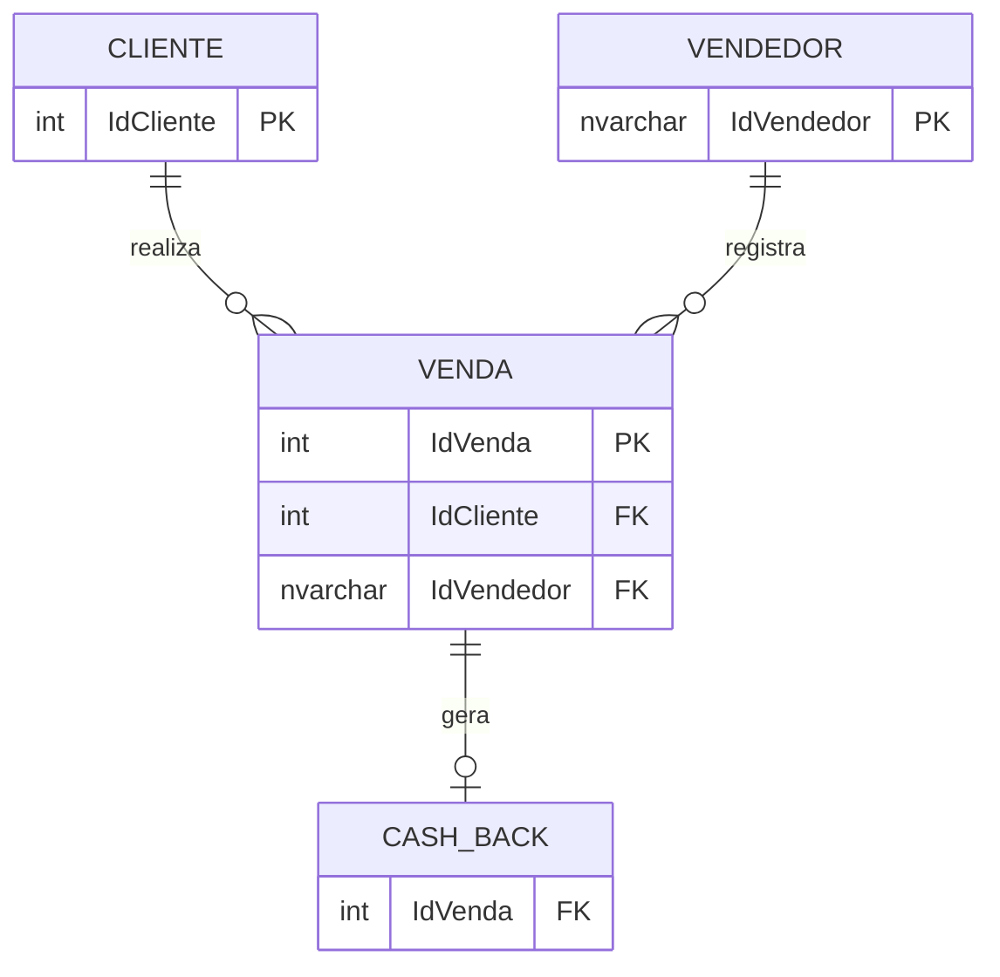

# 👓 Análise de Vendas e Cashback — Banco de Dados para Ótica

> **English summary:** Sales and cashback tracking database for an optical store, built in SQL Server with fictional data. It covers table modeling, primary and foreign keys, `INNER JOIN` queries and aggregations. A Power BI dashboard is planned as the next step.

## Sobre o projeto

Este é o meu **primeiro projeto de banco de dados**. A ideia nasceu da rotina da ótica onde trabalho: acompanhar as vendas, saber quanto cada vendedor vendeu e incentivar o cliente a voltar à loja com um desconto (cashback).

O objetivo é colocar em prática o que aprendi de SQL Server, estrutura de dados e relacionamento entre tabelas, e criar uma base que, no futuro, alimente um dashboard no Power BI.

## O que eu pratiquei

- Modelagem de tabelas e escolha de tipos de dados
- Chaves primárias (PK) e estrangeiras (FK)
- `INNER JOIN` entre duas e três tabelas
- Filtros com `WHERE` e agregações com `GROUP BY`, `COUNT` e `SUM`
- Cálculo de valores a partir de outras tabelas (`INSERT ... SELECT`)

## Modelo de dados



| Tabela | O que guarda |
|---|---|
| `Cliente` | Cadastro: nome, CPF, telefone, e-mail, CEP e profissão |
| `Vendedor` | Nome e identificador de cada vendedor |
| `Venda` | Lente, preço, datas, forma de pagamento, e o cliente e o vendedor da venda |
| `Cash_Back` | Valor do desconto, código de resgate e a venda de origem |

## Regras de negócio

- O **benefício do cashback** é de **15% do preço** da venda.
- O **código de resgate** são os **4 primeiros dígitos do CPF** do cliente.

## Estrutura do repositório

```
├── 01_criar_tabelas.sql   -- criação das tabelas e das chaves estrangeiras
├── 02_dados_teste.sql     -- dados fictícios (clientes, vendedores, vendas e cashback)
├── 03_consultas.sql       -- consultas com INNER JOIN
└── README.md
```

## Como executar

1. Tenha o **SQL Server** e o **SQL Server Management Studio (SSMS)** instalados.
2. Crie um banco de dados vazio:
   ```sql
   CREATE DATABASE AnaliseOptica;
   ```
3. Abra e rode os arquivos **nesta ordem**: `01_criar_tabelas.sql`, `02_dados_teste.sql` e `03_consultas.sql`.

Os arquivos começam com `USE AnaliseOptica;`. Se você criou o banco com outro nome, ajuste essa linha nos três arquivos.

## Consultas incluídas

1. Vendas com o nome do cliente
2. Vendas com o nome do vendedor
3. Vendas com cliente e vendedor juntos (três tabelas)
4. Vendas acima de R$ 2.000
5. Total vendido por vendedor
6. Cashback de cada cliente

## Desafios e aprendizados

- **CPF importado do Excel como `float`.** Os CPFs viraram notação científica e perderam os zeros à esquerda. Corrigi convertendo a coluna para `VARCHAR(11)`, e entendi por que CPF deve ser texto e não número.
- **Vínculo entre as tabelas.** Como as vendas não tinham cliente nem vendedor, criei as colunas de chave estrangeira e distribuí os vínculos para ter dados de teste coerentes.
- **Entender o `INNER JOIN`.** A ligação é sempre uma chave estrangeira de uma tabela comparada com a chave primária da outra.
- **Codificação dos arquivos.** O SQL Server gerou o script em UTF-16, e os acentos apareceram quebrados. Salvei os arquivos em UTF-8.
- **Limitação conhecida.** O código de resgate usa só 4 dígitos do CPF, então não é único nem seguro. Para o estudo funciona, mas em um sistema real seria melhor um código aleatório.

## Próximos passos

- [ ] Criar o dashboard no **Power BI** com os resultados (total por vendedor, vendas por período, cashback)
- [ ] Adicionar uma chave primária própria à tabela `Cash_Back`
- [ ] Criar *views* com as consultas mais usadas
- [ ] Padronizar os nomes das colunas sem acentos (por exemplo, `Preço` para `Preco`)

## Sobre os dados

Todos os dados deste repositório são **fictícios**. Nomes, CPFs, telefones, e-mails e valores foram inventados para o estudo, e qualquer semelhança com pessoas reais é coincidência.

## Autor

**Melke** — estudante de Análise e Desenvolvimento de Sistemas.

- LinkedIn: [adicione o link do seu perfil]
- GitHub: [adicione o link do seu perfil]
